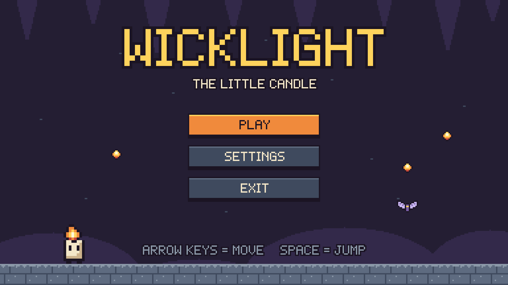
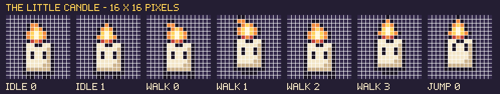
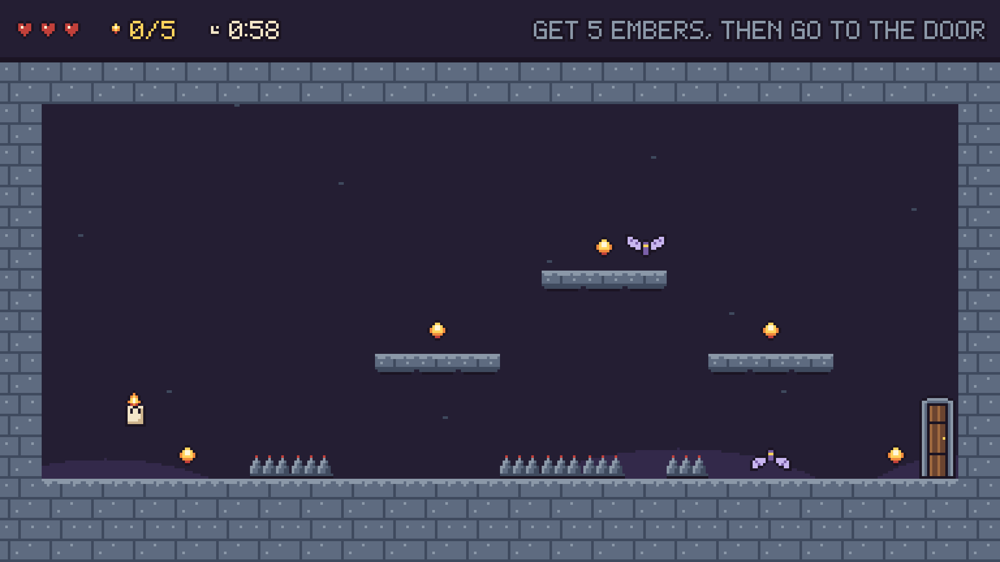
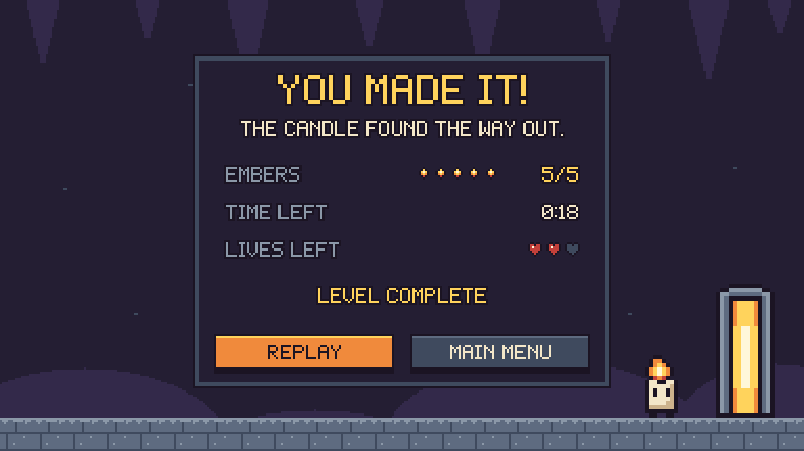
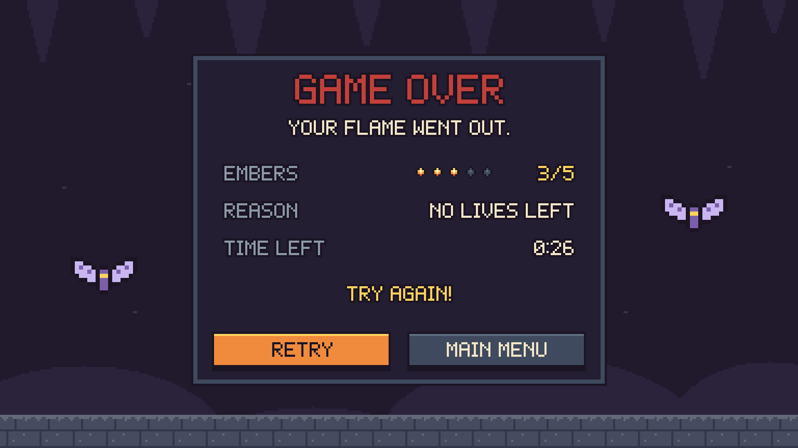

# WICKLIGHT – The Little Candle
### Game Design Document (CA1 – Design a 2D Game)



| | |
|---|---|
| **Game title** | WICKLIGHT – The Little Candle |
| **Theme** | No Risk? No Reward! |
| **Genre** | 2D pixel-art platform game (run and jump) |
| **Players** | 1 |
| **Length** | One level, 60 seconds |

## 1. Short pitch

You are a little candle lost in a dark cave. Collect five glowing embers, jump over spikes, avoid the moths and reach the exit door before your 60 seconds run out.

## 2. Target audience

- Players aged 8 and up.
- New players who like simple platform games.
- The game uses only three keys, so anyone can learn it in a few seconds.

## 3. Story

A little candle wakes up deep inside a dark cave. The exit door is locked, and it only opens with the light of five embers. The candle has only one minute before its flame goes out. It must find the five embers and get out.

## 4. Setting

A dark purple cave with stone walls, stone platforms, sharp spikes on the floor and a wooden door at the end. The candle and the embers are the only warm, bright things in the cave.

## 5. Player character



- A small white candle with a flame on top, two dot eyes and two small feet.
- Size: 16 × 16 pixels.
- Animations: **idle** (2 frames, the flame flickers), **walk** (4 frames, the feet move and the flame leans back) and **jump** (1 frame, the eyes look up).

## 6. Main objective

Collect all **5 embers**, then walk into the **exit door** before the timer reaches zero.

## 7. Core mechanic

**Run, jump and collect.** The candle runs left and right and jumps between platforms. Every ember is placed next to a danger (spikes or a moth). Getting an ember is a small risk, but you need all five to win. This is the "No Risk? No Reward!" idea.

## 8. Controls

| Key | Action |
|---|---|
| Left arrow | Move left |
| Right arrow | Move right |
| Spacebar | Jump |

The candle can jump **3 tiles high** and across a gap of up to **4 tiles**.

## 9. Rules

1. You start with **3 lives** and **60 seconds**.
2. The timer goes down all the time.
3. Touch an **ember** to collect it. The ember counter goes up by 1.
4. If you touch **spikes** or a **moth**, you lose 1 life and go back to the start point. The embers you already have stay collected.
5. The **exit door** stays closed until you have all 5 embers. Then it opens.
6. Walk into the open door to finish the level.

## 10. Collectibles

| | Item | How many | What it does |
|---|---|:---:|---|
|  | **Ember** | 5 | Adds 1 to the ember counter. You need all 5 to open the door. |

## 11. Hazards and enemies

| | Name | How many | What it does |
|---|---|:---:|---|
|  | **Spikes** | 3 groups | They stay still on the floor. Touching them costs 1 life. |
|  | **Moth** | 2 | It flies left and right along a short path, then turns around. Touching it costs 1 life. |

## 12. Scoring

There are no points in this game. The screen shows three simple things:
- **Embers:** how many you have (for example 2/5).
- **Time:** how many seconds are left.
- **Lives:** how many hearts are left.

The Victory screen shows your embers, the time left and the lives left.

## 13. Win condition

Collect all **5 embers** and walk into the **exit door** before the timer reaches **0:00**.

## 14. Lose conditions

- You lose all **3 lives**, **or**
- The timer reaches **0:00**.

## 15. Gameplay loop

```
   Start ──► Move and jump ──► Collect an ember ──► All 5 embers? ──yes──► Go to the door ──► WIN
                 ▲                                       │
                 │                                       no
                 └───────────────────────────────────────┘

   Touch spikes or a moth ──► lose 1 life ──► back to the start ──► keep playing
   No lives left, or time reaches 0:00 ──► GAME OVER
```

## 16. Screens

| | |
|---|---|
|  **Main Menu** |  **Gameplay** |
|  **Victory** |  **Game Over** |
