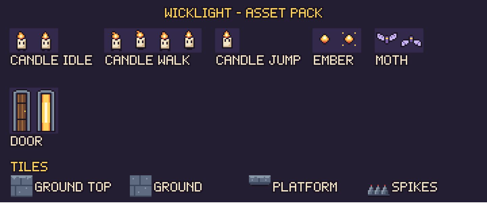
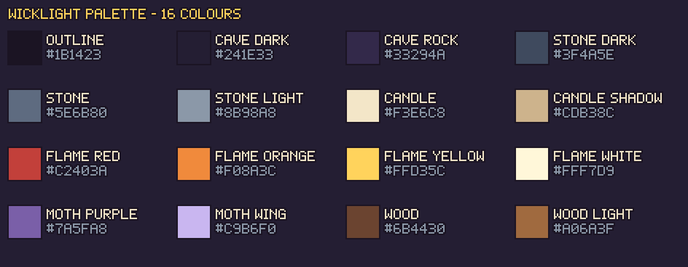
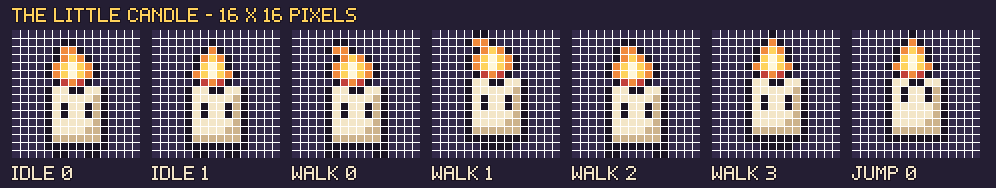

# WICKLIGHT – Pixel Art Assets

- All art is pixel art on a **16 × 16 pixel grid**. (The door is 16 × 32.)
- Every PNG has a **see-through background**, but not the cave background.
- The art uses only **16 colours**.
- The pictures in `preview/` are big copies, only for looking at. Use the small files in Piskel or in a game engine.

## Art style

- Simple shapes with a dark outline.
- Warm colours (yellow, orange, red) for the candle, the embers and the open door.
- Cool colours (purple, grey) for the cave, the stone and the moths.

## Colours (`palette/`)

- `wicklight.gpl`: the 16 colours for Piskel (also works in GIMP and Aseprite)
- `wicklight.hex`: the colour codes as text
- `palette.png`: a picture of the 16 colours with their names

## List of assets

| Asset | File | Size | Frames |
|---|---|---|:---:|
| Candle (player) – idle | `sprites/player/candle_idle_0.png`, `candle_idle_1.png` | 16 × 16 | 2 |
| Candle – walk | `sprites/player/candle_walk_0.png` to `candle_walk_3.png` | 16 × 16 | 4 |
| Candle – jump | `sprites/player/candle_jump_0.png` | 16 × 16 | 1 |
| Ember (collectible) | `sprites/ember/ember_0.png`, `ember_1.png` | 16 × 16 | 2 |
| Moth (enemy) | `sprites/moth/moth_0.png`, `moth_1.png` | 16 × 16 | 2 |
| Exit door | `sprites/door/door_closed.png`, `door_open.png` | 16 × 32 | 2 |
| Spikes (hazard) | `tiles/3_spikes.png` | 16 × 16 | 1 |
| Ground and platform tiles | `tiles/0_ground_top.png`, `1_ground.png`, `2_platform.png` | 16 × 16 | 1 each |
| Tileset (all 4 tiles) | `tiles/tileset.png` | 64 × 16 | – |
| Cave background | `background/cave_background.png` | 384 × 216 | – |

### The 4 tiles in `tileset.png`

| Number | Tile | Use |
|:---:|---|---|
| 0 | ground_top | The top of the ground. You stand on it. |
| 1 | ground | Ground under the top row, and the cave walls |
| 2 | platform | A stone platform in the air |
| 3 | spikes | Danger on the floor |

## Sprite sheets (`spritesheets/`)

- One strip for each animation: `candle_idle_strip2.png`, `candle_walk_strip4.png`, `candle_jump_strip1.png`, `ember_strip2.png`, `moth_strip2.png`, `door_strip2.png`. The frames are side by side, with no space between them.
- `wicklight_spritesheet.png`: all animations in one picture, one animation in each row.
- `spritesheets.json`: the frame size, the number of frames and the speed of each animation.

| Animation | Frames | Speed (frames per second) |
|---|:---:|:---:|
| candle_idle | 2 | 3 |
| candle_walk | 4 | 8 |
| candle_jump | 1 | – |
| ember | 2 | 4 |
| moth | 2 | 6 |
| door (closed, open) | 2 | – (it opens when you have 5 embers) |

## UI pieces (`ui/`)

These are the parts used on the 4 screens.
- `buttons/`: PLAY, SETTINGS, EXIT, REPLAY, RETRY and MAIN MENU. Each button has a normal look and a selected look.
- `icons/`: full heart, empty heart, ember, empty ember and clock
- `panel.png`: a dark box with a border
- `font_sheet.png`: the pixel letters

## Piskel files (`piskel/`)

There are 6 Piskel files. You can open and change them in Piskel:

| File | Frames | Size | Speed |
|---|:---:|---|:---:|
| `candle_idle.piskel` | 2 | 16 × 16 | 3 FPS |
| `candle_walk.piskel` | 4 | 16 × 16 | 8 FPS |
| `candle_jump.piskel` | 1 | 16 × 16 | 1 FPS |
| `ember.piskel` | 2 | 16 × 16 | 4 FPS |
| `moth.piskel` | 2 | 16 × 16 | 6 FPS |
| `door.piskel` | 2 | 16 × 32 | 1 FPS |

### How to open a Piskel file

1. Go to [piskelapp.com](https://www.piskelapp.com) and click **Create Sprite**.
2. On the right side, click the **folder icon (Open)**.
3. Click **Browse .piskel files** and choose a file from `piskel/`.
4. All the frames and the speed load. The preview at the top right plays the animation.

### How to use the colours in Piskel

1. Click **Palettes**, then **Import**.
2. Choose `palette/wicklight.gpl`.

### How to open a sprite sheet in Piskel

1. Click **Import**, then **Browse images**, and choose a strip from `spritesheets/`.
2. Choose **Import as spritesheet**. Set the frame size to **16 × 16** (for the door: **16 × 32**).
3. Click **Import**.
