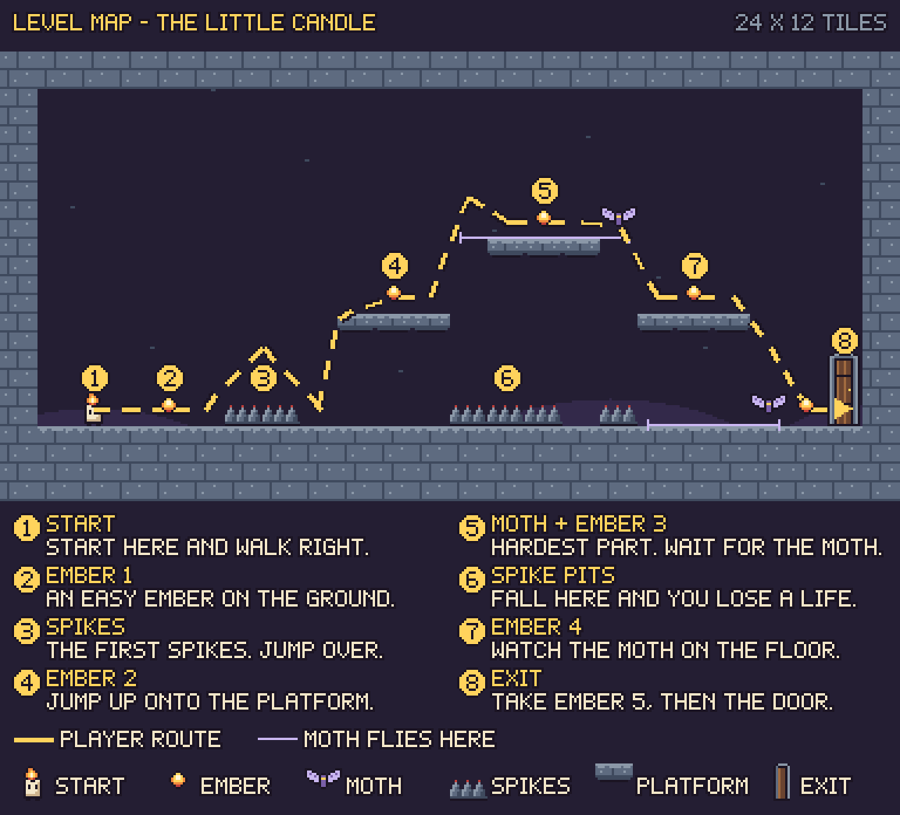
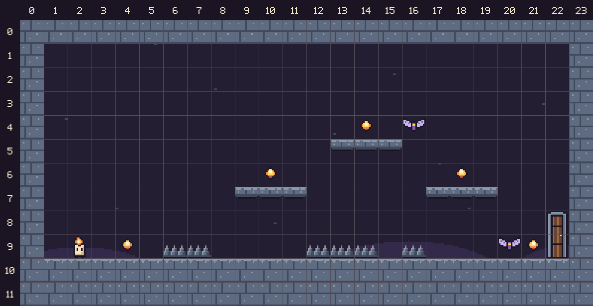

# WICKLIGHT – Level Design

## The level

| | |
|---|---|
| **Size** | 24 × 12 tiles (one screen). One tile is 16 × 16 pixels. |
| **Start** | Bottom left |
| **Exit door** | Bottom right |
| **Embers** | 5 |
| **Spikes** | 3 groups |
| **Moths** | 2 |
| **Platforms** | 3 stone platforms in the air |
| **Time** | 60 seconds |

## Files

| File | What it is |
|---|---|
| `maps/level_map_annotated.png` | The map with the player route, numbered notes and a legend |
| `maps/level_map.png` | The map without notes |
| `maps/level_map_grid.png` | The map with a tile grid and numbers |
| `data/level.txt` | The level as letters. One letter = one tile. |
| `data/level_tiles.csv` | The level as tile numbers (−1 = empty) |
| `data/level.tmj` | The level for the Tiled map editor. It uses `02_Pixel_Art_Assets/tiles/tileset.png`. |

## Map legend

| On the map | Meaning | Letter in `level.txt` |
|---|---|:---:|
| Candle | Start | `P` |
| Glowing dot | Ember | `e` |
| Purple moth | Moth (where it starts) | `M` |
| Grey points | Spikes | `^` |
| Stone ledge | Platform | `=` |
| Stone blocks | Ground and walls | `#` |
| Wooden door | Exit door | `D` |
| Yellow dashed line | Player route | – |
| Thin purple line | Where the moth flies | – |

## The player route (the numbers on the map)

| # | Where | What happens |
|:---:|---|---|
| 1 | Start | The candle starts on the left, on flat and safe ground. The player learns to move here. |
| 2 | Ember 1 | The first ember is on the ground. It is easy to get. |
| 3 | First spikes | Two spikes on the floor. This is the first jump. |
| 4 | Ember 2 | Jump up onto the first platform (3 tiles up) to get the second ember. |
| 5 | Moth + Ember 3 | Jump to the high platform. A moth flies left and right here. Wait for it to fly away, then take the ember. **This is the hardest part.** |
| 6 | Spike pits | There are spikes under the platforms. If you fall, you lose a life and go back to the start. |
| 7 | Ember 4 | Jump down to the third platform. From here you can see the second moth on the floor. |
| 8 | Ember 5 + Exit | Wait for the moth to fly away, jump down, take the last ember and walk into the door. |

## Beginning, middle and end

- **Beginning (1–3):** flat ground, one easy ember and one small jump. The player learns the controls.
- **Middle (4–6):** platforms, the first moth and the spike pits. The game gets harder.
- **End (7–8):** one more moth, the last ember and the door.

## Why things are in these places

- **Embers:** each ember is a little harder to get than the one before. This is the "No Risk? No Reward!" idea.
- **Spikes:** they are under the jumps. If you miss a jump, you lose a life.
- **Moths:** one moth is in the middle of the level (on the high platform). One moth is at the end (near the door).
- **Exit door:** it is at the far right, at the end of the route. The player always knows where to go.

## Can the player make every jump?

Yes. The candle can jump 3 tiles up and over a gap of 4 tiles. Every jump on the route is smaller than this.

| Jump | Up | Gap | OK? |
|---|:---:|:---:|:---:|
| Over the first spikes | 0 | 2 tiles | ✅ |
| Ground → platform 1 | 3 tiles | 0 | ✅ |
| Platform 1 → high platform | 2 tiles | 1 tile | ✅ |
| High platform → platform 3 | down 2 | 1 tile | ✅ |
| Platform 3 → ground | down 3 | 1 tile | ✅ |

