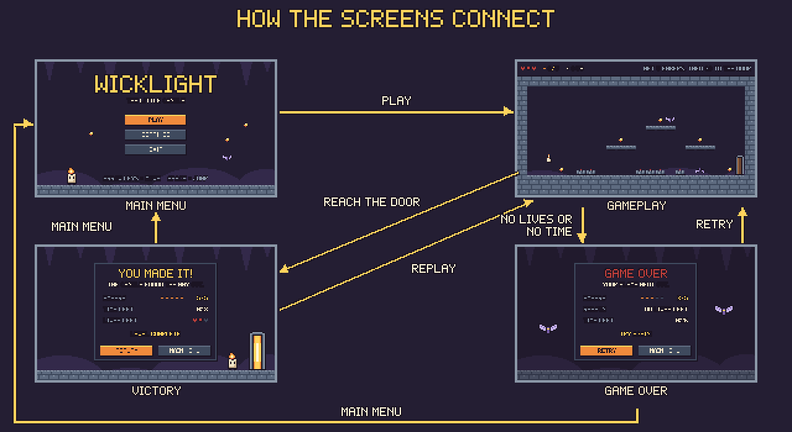
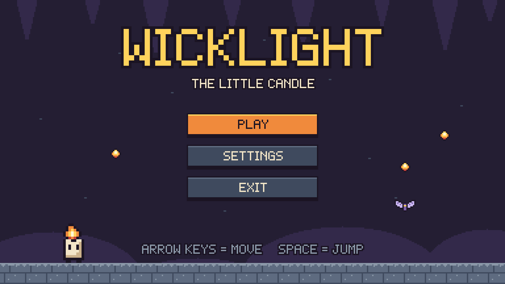
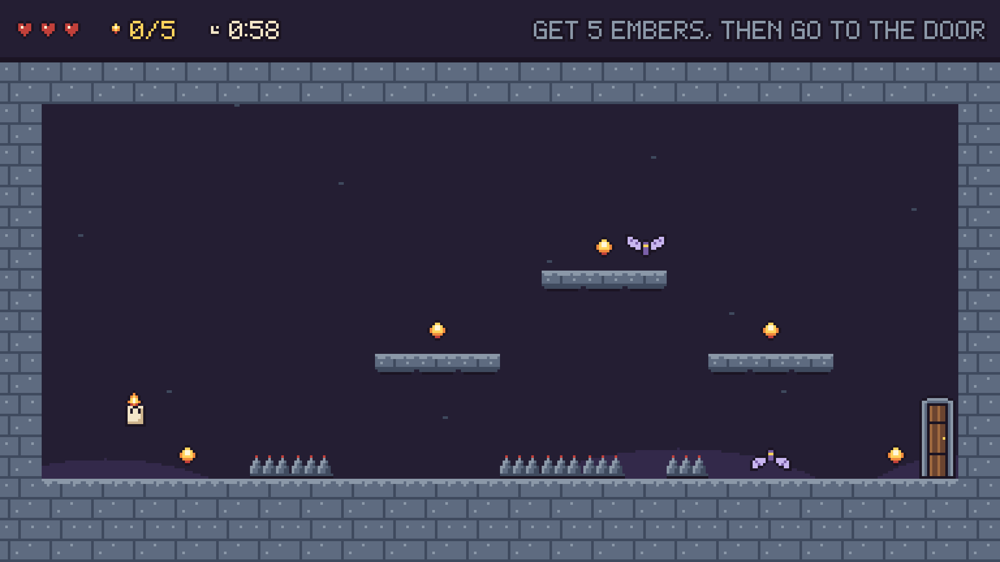
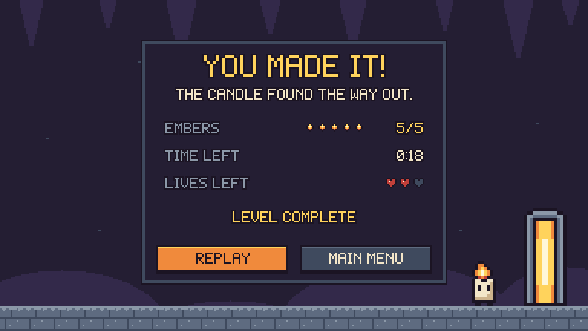
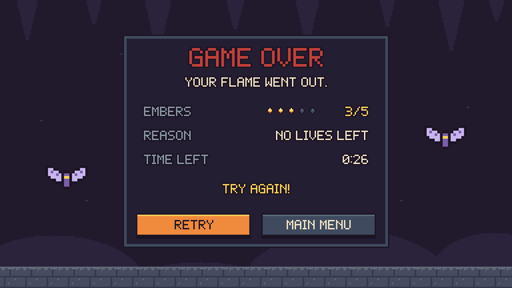

# WICKLIGHT – Game Screens and Prototype

There are 4 screens: **Main Menu**, **Gameplay**, **Victory** and **Game Over**. They all use the same 16 colours, the same pixel letters, the same buttons and the same dark box.

| File | What it is |
|---|---|
| `screens/01_main_menu.png` | Main Menu (1920 × 1080) |
| `screens/02_gameplay.png` | Gameplay (1920 × 1080) |
| `screens/03_victory.png` | Victory (1920 × 1080) |
| `screens/04_game_over.png` | Game Over (1920 × 1080) |
| `screen_flow.png` | A picture of how the screens connect |
| `prototype/index.html` | The HTML prototype (you can click it) |
| `Figma_Guide.md` | How to open and use the Figma prototype |

The screens are made at 384 × 216 pixels and saved 5 times bigger. This keeps the pixels sharp.

## Screen 1: Main Menu

- The name "WICKLIGHT" and "THE LITTLE CANDLE"
- The cave with the candle, embers and a moth
- PLAY, SETTINGS and EXIT buttons
- The controls at the bottom: arrow keys to move, space to jump

## Screen 2: Gameplay

The whole level is on one screen. The bar at the top shows:
- **Lives:** 3 hearts
- **Embers:** 0/5 (the game has just started)
- **Timer:** 0:58 (the game starts at 1:00, that is 60 seconds)
- **Goal:** "GET 5 EMBERS, THEN GO TO THE DOOR"

You can also see the candle, all 5 embers, the 3 platforms, 2 moths, 3 spike groups and the exit door.

## Screen 3: Victory

- "YOU MADE IT!" and "THE CANDLE FOUND THE WAY OUT."
- Embers 5/5, time left 0:18, lives left 2 of 3
- REPLAY and MAIN MENU buttons

## Screen 4: Game Over

- "GAME OVER" and "YOUR FLAME WENT OUT."
- Embers 3/5, the reason (no lives left) and the time left (0:26)
- RETRY and MAIN MENU buttons

## Links between the screens

| From | Click | Goes to |
|---|---|---|
| Main Menu | PLAY | Gameplay |
| Gameplay | The exit door | Victory |
| Gameplay | A moth or spikes | Game Over |
| Victory | REPLAY | Gameplay |
| Victory | MAIN MENU | Main Menu |
| Game Over | RETRY | Gameplay |
| Game Over | MAIN MENU | Main Menu |

SETTINGS and EXIT are only on the screen for the look. They do not go to another screen. There is no settings screen in this assignment.

## The prototype is clicked, not played

The real game is not programmed yet. In the prototype you use the **mouse** to click the buttons, the door, the moths and the spikes. The arrow keys and the spacebar are the controls of the future game.

## HTML prototype

1. Download and unzip the project.
2. Double-click `prototype/index.html`. It opens in your web browser (Chrome, Edge, Firefox or Safari).
3. Click the buttons, or click the door, a moth or the spikes on the gameplay screen.

More things you can do:
- The buttons light up when the mouse is on them.
- Tick **Show click areas** to see all the places you can click.
- **Enter** presses the main button. **Esc** goes back to the Main Menu.
- SETTINGS and EXIT show a short message.

The prototype needs only the files in `prototype/` (`index.html` and the `img/` folder). It does not need the internet. Keep the `img/` folder next to `index.html`.

## Figma prototype

See [`Figma_Guide.md`](Figma_Guide.md).
