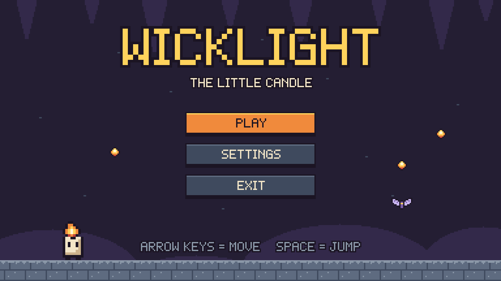
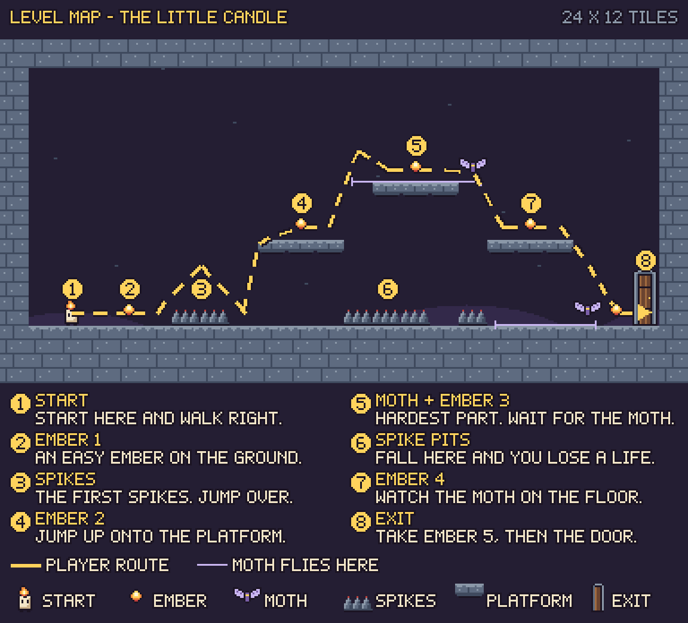

# WICKLIGHT – The Little Candle

**CA1 – Design a 2D Game** · Theme: **No Risk? No Reward!**

You are a little candle in a dark cave. Collect 5 embers, jump over spikes, stay away from the moths and go out through the door. You have 3 lives and 60 seconds.

## What is in this folder

| Folder | What is inside |
|---|---|
| [`01_Game_Concept/`](01_Game_Concept) | The game design document (idea, rules, controls, win and lose) |
| [`02_Pixel_Art_Assets/`](02_Pixel_Art_Assets) | Sprites, tiles, background, sprite sheets, Piskel files and colours |
| [`03_Level_Design/`](03_Level_Design) | The level map, the map with notes, the grid map and the level text |
| [`04_UI_and_Prototype/`](04_UI_and_Prototype) | The 4 game screens, the HTML prototype and the Figma guide |
| [`05_Documentation/`](05_Documentation) | The submission document|

**Start here:** [`05_Documentation/Submission_Document.md`](05_Documentation/Submission_Document.md)

## How to look at the project

You do not need to install anything.

1. **Read the documents.** On GitHub, click a `.md` file. It opens as a page with pictures.
2. **Look at the pictures.** Click any `.png` file.
3. **Try the HTML prototype.** Download the folder (green **Code** button → **Download ZIP**) and unzip it. Then double-click `04_UI_and_Prototype/prototype/index.html`. It opens in your web browser. It works without the internet.
4. **Open the Figma prototype.** Use the Figma link in the [submission document](05_Documentation/Submission_Document.md). Click **Present (▶)** and click with the mouse.
5. **Open the art in Piskel.** Go to [piskelapp.com](https://www.piskelapp.com), click **Create Sprite**, then the **folder icon (Open)**, and choose a file from `02_Pixel_Art_Assets/piskel/`.

